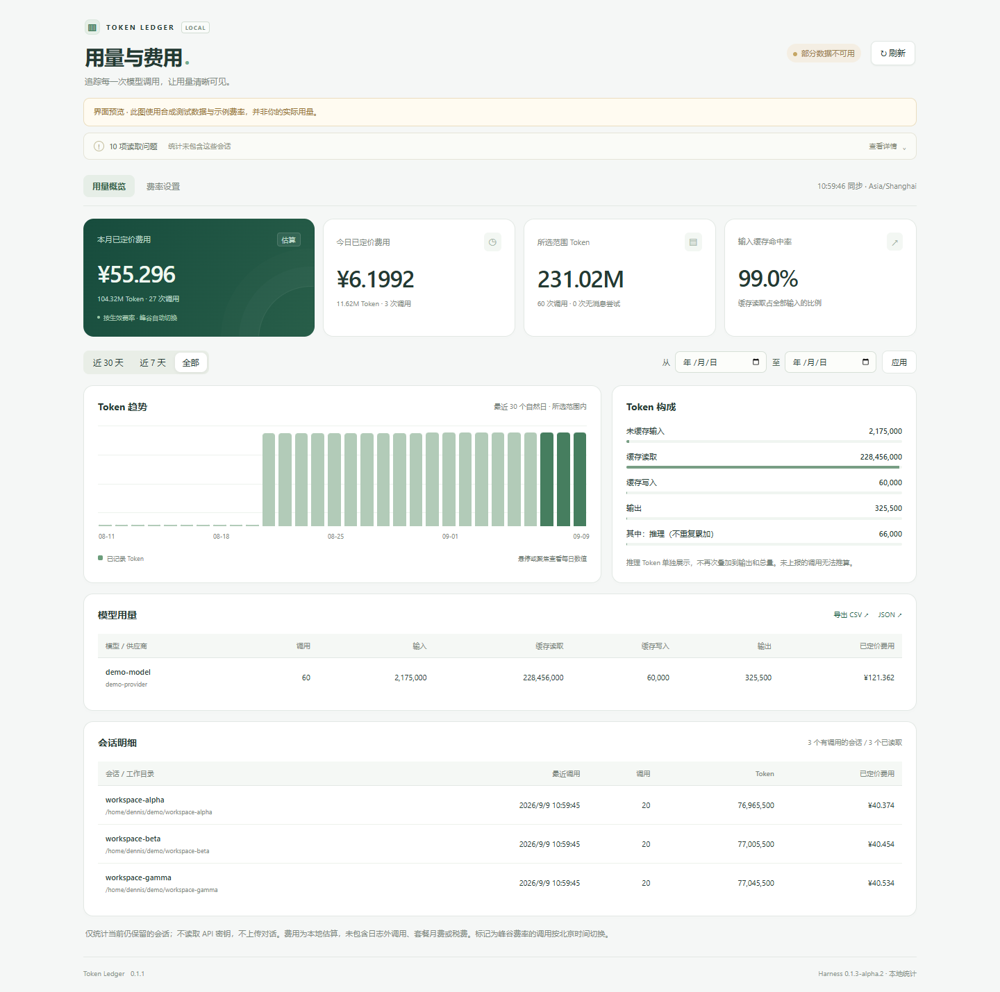
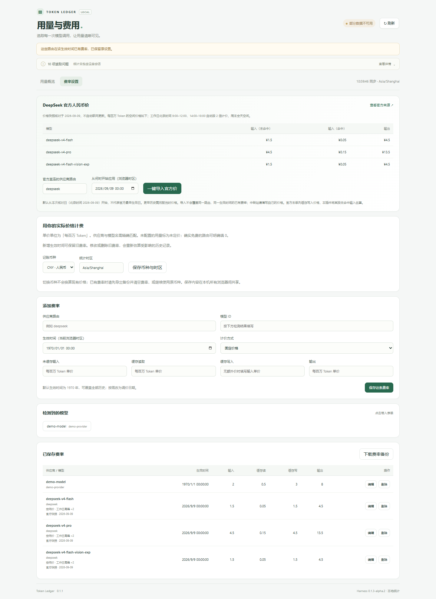
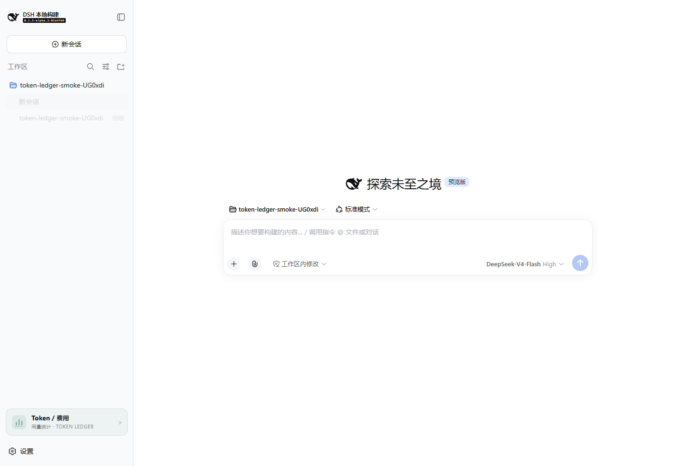
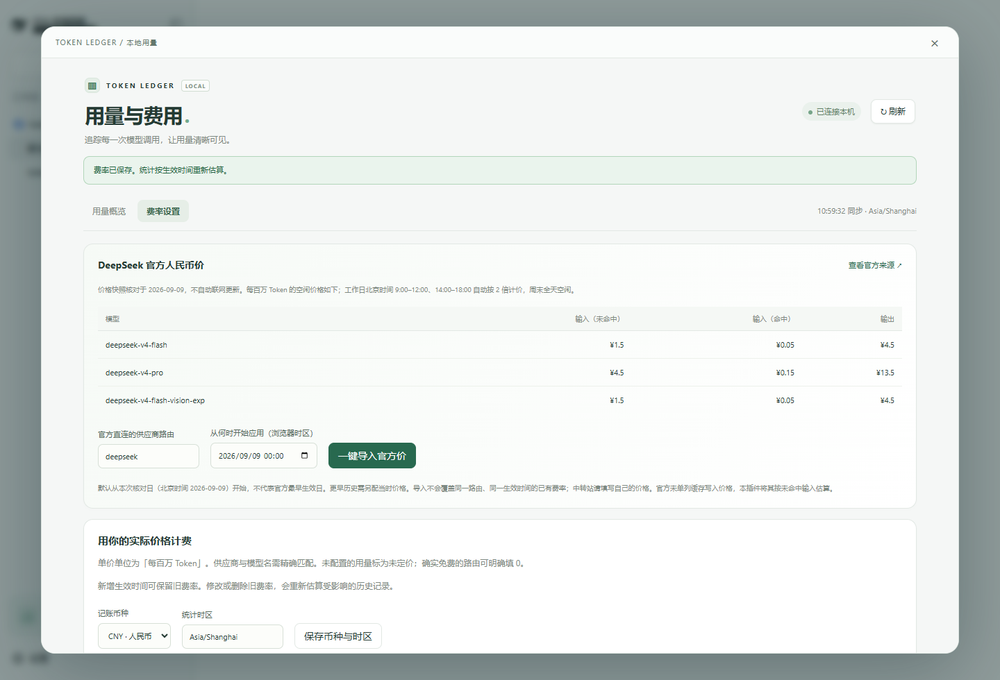
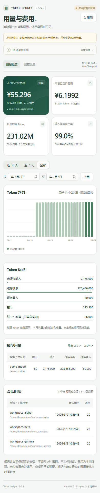

# dsh-bill-visualization

**Local token & cost (bill) visualization dashboard for [DeepSeek Harness](https://github.com/deepseek-ai/deepseek-harness).**

A read-only host plugin (previously shipped as `dsh-token-ledger` / *Token Ledger*) that turns your local Harness session records into a usage and bill dashboard — priced cost for today and this month, token composition, per-model and per-session breakdowns, CSV/JSON export, and one-click import of the official DeepSeek CNY price snapshot with automatic weekday peak/off-peak billing.

> **✅ 适配最新 Harness · Compatible with the latest DeepSeek Harness `0.1.3-alpha.2`**
> Target release `dsh-v0.1.3-alpha.2` (Node **Web** mode). Verified against source commit `82a5fd61a7cf5c293cec4bdff68f455398d685e9` on Node `v22.23.1` — real Cordis activation, real `SessionPersistence` read, real login/401 gate, rate save and reprice all pass. Interface references in [COMPATIBILITY.md](COMPATIBILITY.md).

---

## Screenshots（运行界面）

| | |
| --- | --- |
| **Overview — usage & priced cost**<br/>本月/今日已定价费用、Token 构成、模型用量 | **Rate settings — official price import**<br/>官方价一键导入、峰谷费率、自定义路由 |
|  |  |
| **Sidebar entry in the real Harness host**<br/>真实宿主侧栏、设置上方的入口 | **Official prices page in the real host**<br/>真实宿主中的官方价导入页 |
|  |  |
| **Narrow view**<br/>390px 窄屏不横向溢出 | |
|  | |

*`overview-demo.png` / `rates-demo.png` / `mobile-demo.png` use synthetic usage and example prices — not your data. The two “real Harness” screenshots were taken in an isolated test profile; no production sessions were read and no model was called (details in [TEST-REPORT.md](TEST-REPORT.md)).*

## Features

- **Read-only ledger.** Scans the local Harness session store (`sessionPersistence.list()` → `open(id,'read')` → `SessionHandle.read()`); keeps only counters, timestamps, routes and session IDs in memory — never conversation text, never your API keys, nothing uploaded.
- **Today / this month priced cost** cards plus an arbitrary date range; calendar cards stay independent of the table filter.
- Token **composition**, a last-30-day **trend chart**, and **per-model / per-session** tables with cost; large numbers compacted with hover precision.
- **Official DeepSeek CNY snapshot** bundled (see [Prices](#prices)) — no live fetch, no auto-update; add an older effective time to price history correctly.
- CSV / JSON export, atomic rate-file writes, 401/403-gated local HTTP routes.
- Peak/off-peak switching uses **Beijing time** regardless of display timezone; weekends are off-peak all day.

## Installation

Works with a DeepSeek Harness source checkout at the pinned release (`pnpm run dsh --version` → `0.1.3-alpha.2`):

```bash
# stop the running harness first (Ctrl+C in its terminal)
cd ~/deepseek-harness
pnpm run dsh plugin --profile web add /path/to/dsh-bill-visualization-0.1.2.tgz
pnpm run dsh web
```

Then open the freshly printed login link and hard-refresh (`Ctrl+F5`). The **“Token / 费用”** entry appears in the left sidebar above **Settings**; when collapsed the sidebar shows an icon. You can also open `http://127.0.0.1:3080/dsh-bill-visualization` directly (port as printed by your boot log). Upgrading from `dsh-token-ledger` 0.1.x keeps your existing rate file.

> Only use **`pnpm run dsh`**. The bare system `dsh` command is *Distributed Shell* — a different program.

### Uninstall

```bash
# Ctrl+C first
cd ~/deepseek-harness
pnpm run dsh plugin --profile web remove dsh-bill-visualization
pnpm run dsh web
```

Uninstalling never deletes your rate file.

## First run & rates

1. Talk to a model once, then refresh the stats page. Sessions become readable after Harness persists them (stats cache ≤15 s, auto-refresh every 30 s).
2. **Official DeepSeek direct**: open 费率设置 → check the provider route (default `deepseek`) → **一键导入官方价** (import is idempotent; an existing price for the same route/model/effective instant is kept).
3. **Relays / other routes**: click the detected provider/model chips and enter your own price per **1M tokens** (uncached input, cache-read, cache-write, output). If cache-write costs the same as normal input, enter the same price; only enter `0` when it is really free.
4. Effective time defaults to 1970 so it covers all history; when a price changes, add a new row with the new effective time — old calls keep matching the old rate.

### Prices

Bundled official CNY snapshot (checked 2026-09-09; per 1M tokens, **off-peak**; weekday peak Beijing 09:00–12:00 & 14:00–18:00 = ×2):

| Model | Input (cache miss) | Input (cache hit) | Output |
| --- | --- | --- | --- |
| deepseek-v4-flash | 1 | 0.02 | 4 |
| deepseek-v4-pro | 4.5 | 0.15 | 13.5 |
| deepseek-v4-flash-vision-exp | 1 | 0.02 | 4 |

The snapshot applies the **Flash-series** cut announced for **2026-09-10 12:00 Beijing** (official announcement, [IT之家](https://m.ithome.com/html/999953.htm) / [快科技](https://www.chinaz.com/2026/0909/1776003.shtml)); `deepseek-v4-pro` was not adjusted. Effective-from is `2026-09-10T04:00:00Z`; earlier calls need the rates that were actually in force (the page does not publish a full historical table). The official page lists no separate cache-write price, so this plugin estimates cache-write at the cache-miss input price. Image tokens are vendor-reported; the plugin adds nothing.

## Counting semantics

- Reads usage from `assistant/message` and the last usage snapshot of `assistant/attempt`; an attempt counts once (summary and stream are not double-counted).
- In this version `inputTokens` is **uncached** input already. Total = uncached input + cache read + cache write + output; `reasoningTokens` is shown separately and never added again.
- Fork-inherited events (`inheritedEventCount`) are excluded to avoid double counting; ordinary resumed sessions still count their older calls.
- Only currently retained sessions are counted; deleting a session removes it on the next scan (no permanent ledger in this version).
- Costs are an **estimate from your configured rates** — not the vendor bill. Excluded: requests outside session logs, balance queries, plan monthly fees, taxes, search-tool extras, standalone summarization/titling.
- Only rates that opt into the peak schedule are time-adjusted.

## Configuration

No configuration is required by default. To tune data path or limits, override the fields in your profile user patch:

| Field | Default | Meaning |
| --- | --- | --- |
| `dataDir` | `$DSH_HOME/dsh-bill-visualization` | Rate-file directory (absolute path) |
| `cacheMs` | `15000` | Scan cache (1000–3600000 ms) |
| `maxSessions` | `10000` | Max sessions read; overflow is reported explicitly |
| `maxEventsPerSession` | `1000000` | Per-session event cap; overflowing sessions are skipped and reported |
| `readTimeoutMs` | `30000` | List/session read timeout (1000–300000 ms) |

## Development & tests

```bash
node --test tests/*.test.js   # 36 tests — unit + HTTP integration
```

Optional browser QA: install Playwright, set `PLAYWRIGHT_PATH` (package path) and optionally `BROWSER_PATH`, then `node scripts/browser-smoke.mjs qa`. Screenshots use clearly-labeled synthetic data. `scripts/harness-smoke.mjs` runs the real host only inside a fresh temporary `DSH_HOME`. Test record: [TEST-REPORT.md](TEST-REPORT.md).

License: MIT. Independent implementation referencing DeepSeek Harness public interfaces.

---

## 中文说明

**dsh-bill-visualization**（曾用包名 `dsh-token-ledger` / Token Ledger）是为 **DeepSeek Harness 0.1.3-alpha.2**（最新版，Node Web 模式）适配的本地 Token／费用统计插件：展示今日／本月已定价费用、Token 构成、按模型与会话汇总、CSV/JSON 导出，并可一键导入带工作日峰谷（北京 09:00–12:00、14:00–18:00 ×2、周末全天空闲）的 DeepSeek 官方人民币价。**只读**本地会话：不读 API 密钥、不上传对话、不写会话；只写自己的费率文件 `$DSH_HOME/dsh-bill-visualization/rates.json`。已随包携带 2026-09-10 12:00 生效的 Flash 系列新价（命中 0.02／未命中 1／输出 4，pro 未调价）。

- 界面截图见上方（合成数据或隔离的真实宿主测试配置，非真实账单）。
- 安装：`pnpm run dsh plugin --profile web add <dsh-bill-visualization-0.1.2.tgz>` → 重启 `pnpm run dsh web` → 侧栏「设置」上方出现 **Token / 费用** 入口（或直接访问 `/dsh-bill-visualization`）。从 0.1.x 升级会保留费率文件。
- 费率：官方直连默认路由 `deepseek`，点「一键导入官方价」；中转站填自己的价格；同路由不同生效时间可实现历史调价。
- 计数口径与可选配置见上方英文节；卸载用 `pnpm run dsh plugin --profile web remove dsh-bill-visualization`。
- 测试：`node --test tests/*.test.js`（36 项通过）。
